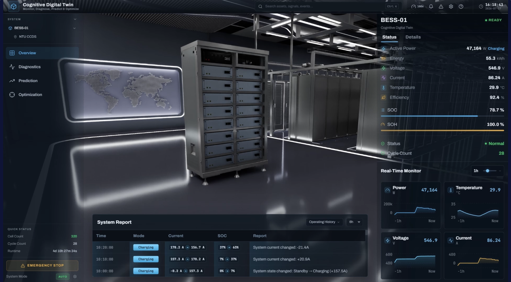
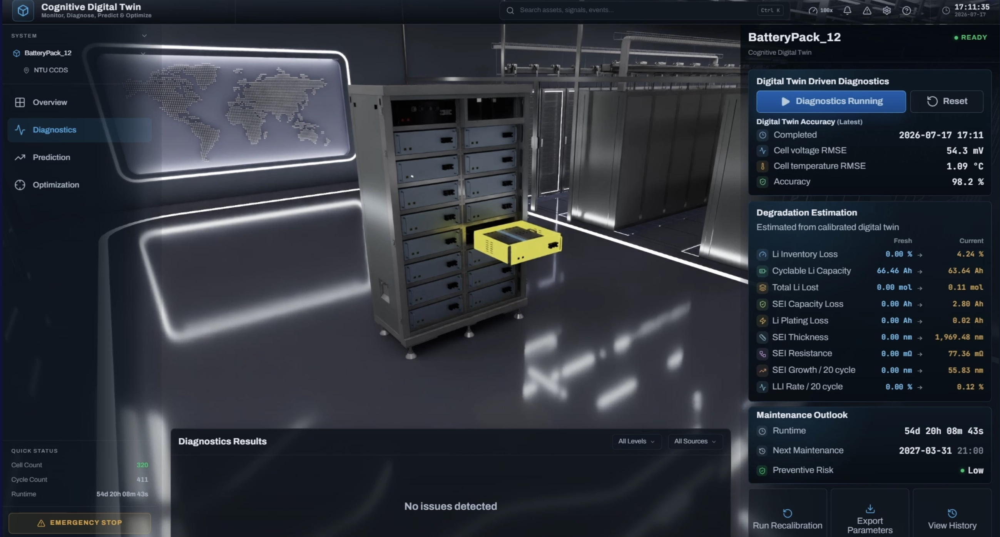
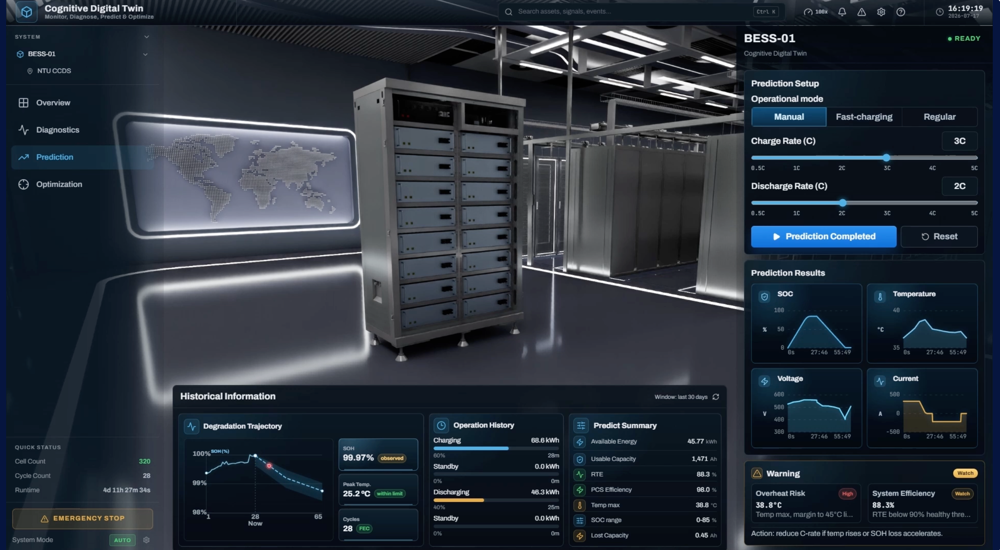
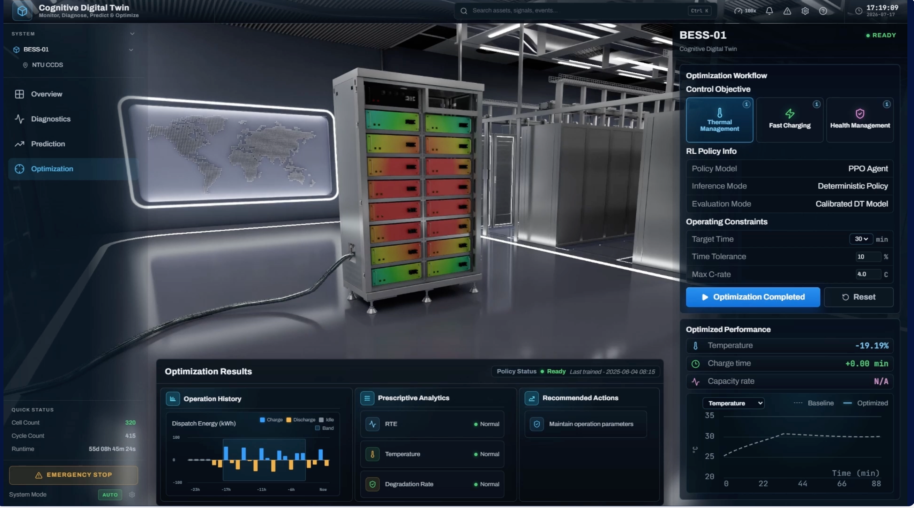

# BatteryTwin: A Physics-Grounded Digital Twin and Benchmark for Battery Data Curation

> **🎉 Accepted to the KDD 2027 Research Track** (33rd ACM SIGKDD Conference on Knowledge Discovery and Data Mining).

<p align="center">
  
</p>

This repository contains the core implementation of **BatteryTwin**, a physics-grounded battery data-curation system accompanying the paper *BatteryTwin: A Physics-Grounded Digital Twin and Benchmark for Battery Data Curation*, accepted to the KDD 2027 Research Track.

BatteryTwin calibrates a cell-specific electrochemical digital twin from limited measurements, uses the calibrated twin to generate physically admissible trajectories and latent states, and applies a physics guardrail to detect and repair inconsistent battery records.

## Why BatteryTwin

Battery aging data are expensive to obtain, sparse in extreme operating regimes, and limited to externally observable signals. BatteryTwin treats a calibrated digital twin as a data-engineering component:

- It identifies cell-specific physical parameters from voltage, current, temperature, and capacity measurements.
- It simulates virtual aging trajectories under configurable current, temperature, and cycling protocols.
- It exposes simulated internal quantities that are not directly measured by routine sensors.
- It audits trajectories against physical constraints and repairs only the segments that violate them.

The accompanying manuscript reports a five-dimensional evaluation covering predictive accuracy, out-of-distribution generalization, data efficiency, robustness, and physical interpretability. In that evaluation, BatteryTwin reduces SOH-estimation error by 29.7% on average and reduces the real-data budget needed for a target accuracy by up to 78%.

## System Overview

```text
Measured battery data
  voltage, current, temperature, capacity
                |
                v
Physics-informed calibration
  inverse warm start + constrained parameter search
                |
                v
Calibrated DFN digital twin
  electrochemistry + lumped thermal dynamics + degradation
                |
       +--------+--------+
       |                 |
       v                 v
Virtual data curation    Physics guardrail
  trajectories           detect -> grade -> repair
  internal states
       |                 |
       +--------+--------+
                v
Physics-consistent curated battery data
```

## Implemented BatteryTwin System

BatteryTwin has been realized as an end-to-end system demonstrator rather than only a collection of offline model routines. The system connects battery measurements, a continuously calibrated electrochemical twin, physics-grounded diagnostics, counterfactual simulation, and decision support in one operational workflow. A companion demo video records this workflow in action; the five views below show the corresponding implemented capabilities.

Together, these views provide the system-level counterpart of the paper's technical pipeline: experimental observations synchronize the twin, the calibrated model exposes otherwise unobservable degradation states, the virtual laboratory evaluates unseen operating regimes, and physics-aware monitoring keeps model outputs and battery records within admissible behavior.

### 1. Physical-to-digital synchronization


The opening view presents the central abstraction of BatteryTwin: a persistent mapping between the physical battery system and its computational counterpart. Measurements from the real asset anchor the digital representation, while the calibrated twin provides a physics-consistent state space in which the battery can be inspected beyond the externally measured signals. This bidirectional perspective underlies the paper's use of the twin as continuously synchronized data infrastructure.

### 2. Unified real-time observability



The overview consolidates asset status, power and energy flow, voltage, current, temperature, efficiency, SOC, SOH, cycle count, short-horizon trends, and operating events. It turns the measurement vector used by the calibration stack into an operational monitoring surface and maintains a common context for simulation, diagnostics, and data curation. The result is traceable alignment between incoming observations and the state of the calibrated twin.

### 3. Physics-grounded diagnostics and latent-state inspection



The diagnostics view evaluates agreement between the physical asset and the calibrated twin through voltage and temperature residual metrics, while exposing degradation quantities that routine sensors cannot directly observe. These include lithium-inventory loss, cyclable-lithium capacity, SEI-related loss and resistance, lithium-plating loss, and degradation rates. This view operationalizes two central claims of the paper: calibration is a standing synchronization mechanism, and physical interpretability comes from inspecting meaningful internal states rather than relying only on a black-box health score. Diagnostic outcomes can also trigger recalibration and support physics-based anomaly review.

### 4. Counterfactual prediction as a virtual battery laboratory



The prediction workspace exposes configurable charge and discharge rates and returns synchronized SOC, temperature, voltage, and current trajectories, together with degradation history, energy and capacity summaries, and operating warnings. This is the interactive realization of BatteryTwin's data-augmentation engine: a calibrated cell can be exercised under shifted, extreme, or otherwise costly operating conditions without requiring a new physical aging campaign. The generated trajectories remain coupled through the same electrochemical, thermal, and degradation dynamics used during calibration.

### 5. Constraint-aware operational optimization



The optimization view demonstrates the downstream decision layer enabled by the calibrated twin. An operator can select thermal-management, fast-charging, or health-management objectives, impose operating limits, evaluate a candidate policy against the digital twin, and compare baseline and optimized behavior before applying a recommendation to the physical asset. In this role, BatteryTwin acts as a physics-grounded evaluation environment: proposed actions are assessed against predicted temperature, charge time, efficiency, and degradation behavior rather than optimized against an unconstrained surrogate alone.

The complete demonstration therefore spans the full operational loop:

```text
physical asset -> synchronized twin -> diagnostics -> prediction -> constrained decision support
       ^                                                                    |
       +-------------------------- new observations -------------------------+
```

## Paper-to-Code Map

The table below links the main technical elements described in the paper to their implementation in this release.

| Paper component | Implementation | What it provides |
| --- | --- | --- |
| Physics-grounded battery twin | [`dfn_model.py`](src/batterytwin/digital_twin/dfn_model.py), [`simulator.py`](src/batterytwin/digital_twin/simulator.py) | PyBaMM DFN model construction, lumped thermal dynamics, optional SEI and lithium-plating degradation, single-cycle simulation, and multi-cycle aging simulation. |
| Cell-specific Stage 1 calibration | [`stage1.py`](src/batterytwin/calibration/stage1.py), [`optimization.py`](src/batterytwin/calibration/optimization.py) | Fits electrochemical and thermal parameters to measured discharge voltage and temperature using a weighted objective and differential evolution with optional local polishing. |
| Stage 2 degradation calibration | [`stage2.py`](src/batterytwin/calibration/stage2.py) | Fits SEI, lithium-plating, and dead-lithium parameters against multi-cycle SOH degradation. |
| Learned inverse initialization | [`inverse_initializer.py`](src/batterytwin/calibration/inverse_initializer.py), [`feature_preprocess.py`](src/batterytwin/calibration/feature_preprocess.py), [`param_codec.py`](src/batterytwin/calibration/param_codec.py) | Optional CNN-based parameter initialization with uncertainty estimates for constructing a warm-start population for numerical calibration. |
| Virtual data generation | [`simulator.py`](src/batterytwin/digital_twin/simulator.py) | Simulates voltage, temperature, SOH, time axes, charge summaries, and optional electrolyte and solid-surface concentration states under configurable protocols. |
| DT-reference construction | [`dt_reference.py`](src/batterytwin/guardrail/dt_reference.py) | Resamples measured discharge cycles and generates aligned digital-twin voltage and temperature references. |
| Physics guardrail | [`detector.py`](src/batterytwin/guardrail/detector.py), [`repair.py`](src/batterytwin/guardrail/repair.py), [`api.py`](src/batterytwin/guardrail/api.py) | Detects physical inconsistencies, assigns severity, and applies a local repair appropriate to the detected fault. |

## Core Technical Components

### 1. Physics-grounded digital twin

The twin is a Doyle-Fuller-Newman (DFN) model implemented with PyBaMM. It uses a lumped thermal model and can activate SEI growth and partially reversible lithium plating for degradation simulation. The calibrated parameter update covers geometry, electrolyte transport, diffusivity, exchange-current-density scaling, cation transference, and heat transfer.

`simulate_aging_trajectory()` runs repeated discharge-rest-charge-CV cycles. Its output includes per-cycle SOH, voltage curves, time curves, temperature curves, and, when requested, latent internal-state summaries such as electrolyte concentration and particle-surface concentration.

### 2. Calibration stack

Stage 1 aligns the twin with a measured discharge cycle. Its objective combines voltage agreement, head/tail weighting, voltage-gradient agreement, and an optional temperature term. The optimizer uses differential evolution and can apply a bounded local polish after global search.

Stage 2 takes the Stage 1 parameter record and fits degradation parameters over multiple cycles using simulated and measured SOH trajectories.

The optional inverse initializer accepts resampled voltage, voltage derivative, and temperature signals together with scalar discharge descriptors. It predicts a parameter mean and uncertainty, which can be converted into a bounded warm-start population for the numerical optimizer.

### 3. Physics guardrail

The guardrail is a detect-then-repair system. It uses five complementary checks:

1. Discharge-voltage monotonicity.
2. Voltage-derivative envelope violations.
3. Residuals against the digital-twin reference.
4. Cutoff and curve-structure inconsistencies.
5. Temperature-trend violations.

Flagged samples receive a severity level. Repair is local and tiered:

| Severity | Repair | Implementation |
| --- | --- | --- |
| 1 | Linear interpolation over the affected span | `repair_tier1_interp` |
| 2 | Monotone constrained projection with clean anchors | `repair_tier2_projection` |
| 3 | Digital-twin reference patch with cosine boundary blending | `repair_tier3_patch` |

`process_cycle()` is the unified runtime entry point. It returns the repaired voltage curve, corruption mask, per-sample severity, and highest detected severity.

## Repository Layout

```text
src/batterytwin/
  calibration/
    stage1.py
    stage2.py
    optimization.py
    inverse_initializer.py
    feature_preprocess.py
    param_codec.py
  digital_twin/
    dfn_model.py
    simulator.py
  guardrail/
    dt_reference.py
    detector.py
    repair.py
    api.py
configs/
  calibration.default.json
datasets/
  experimental/
  dt_augmented/
examples/
```

## Datasets

The repository separates data assets by provenance:

| Directory | Contents |
| --- | --- |
| [`datasets/experimental/`](datasets/experimental/) | Download instructions for the real experimental battery dataset. |
| [`datasets/dt_augmented/`](datasets/dt_augmented/) | Two small, fully simulated DT-augmentation examples for inspecting the array format. |

The real experimental battery dataset, containing battery cycling results measured at 2C and 3C C-rates and at 25 °C and 40 °C ambient temperatures, is hosted on OneDrive because of its size:

**[Download the BatteryTwin dataset (OneDrive)](https://entuedu-my.sharepoint.com/:f:/g/personal/tianwen001_e_ntu_edu_sg/IgBUuRkdcQGoT62Vo3JPqvCJAerBQn7HmSPfo838sJILnH8?e=gm1uAy)**

The DT examples included in this repository are fully simulated and can be loaded with NumPy.

If you use the BatteryTwin dataset in your research, please cite our paper (BibTeX in [Citation](#citation)).

## Installation

The core package requires Python 3.10+ and the following scientific dependencies:

```bash
pip install numpy pandas scipy pybamm torch cvxpy
export PYTHONPATH="$PWD/src:$PYTHONPATH"
```

`cvxpy` is required only for severity-2 guardrail repair. `torch` is required only for the optional learned inverse initializer.

## Minimal Usage

### Calibrate a cell

Input CSV files are expected to contain the columns `Cycle`, `Time`, `Voltage`, `Current`, `Capacity`, and `Temperature`. Discharge current is represented as negative in the input file.

```python
from batterytwin.calibration.stage1 import calibrate_cell

result = calibrate_cell(
    csv_path="path/to/cell.csv",
    cell_id="cell_a",
    cycle=1,
    output_dir="calibration_output",
)
```

The returned record includes calibrated parameters, calibration metrics, and paths to the generated JSON records. Stage 2 can then calibrate degradation parameters:

```python
from batterytwin.calibration.stage2 import calibrate_degradation

updated_parameters = calibrate_degradation(
    params_json_path=result["parameters_path"],
    csv_path="path/to/cell.csv",
    n_cycles=100,
)
```

### Generate virtual trajectories and internal states

```python
from batterytwin.digital_twin.simulator import simulate_aging_trajectory

simulation = simulate_aging_trajectory(
    param_dict=updated_parameters,
    protocol={
        "C_rate_charge": 1.0,
        "C_rate_discharge": 1.0,
        "n_cycles": 100,
        "nominal_capacity_Ah": 4.0,
    },
    ambient_temperature_K=298.15,
    extract_internal=True,
)
```

### Audit and repair a cycle

```python
import numpy as np

from batterytwin.guardrail.api import process_cycle
from batterytwin.guardrail.detector import calibrate_env

clean_history = np.load("clean_voltage_history.npy")
environment = calibrate_env(clean_history)
result = process_cycle(
    voltage=np.load("observed_voltage.npy"),
    dt_reference=np.load("dt_voltage_reference.npy"),
    environment=environment,
    temperature=np.load("observed_temperature.npy"),
)
repaired_voltage = result["voltage"]
```

## Citation

If you find BatteryTwin useful in your research, please cite our paper:

```bibtex
@inproceedings{zhu2027batterytwin,
  title     = {BatteryTwin: A Physics-Grounded Digital Twin and Benchmark for Battery Data Curation},
  author    = {Zhu, Tianwen and Wang, Hao and Du, Yingpeng and Su, Lingzhi and Xu, Yan and Wen, Yonggang},
  booktitle = {Proceedings of the 33rd ACM SIGKDD Conference on Knowledge Discovery and Data Mining},
  series    = {KDD '27},
  year      = {2027},
  publisher = {Association for Computing Machinery},
  address   = {San Jose, CA, USA}
}
```
